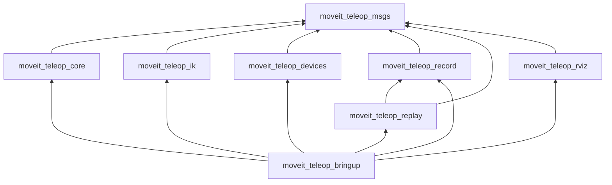
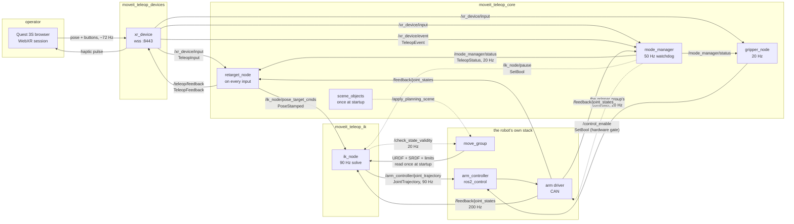
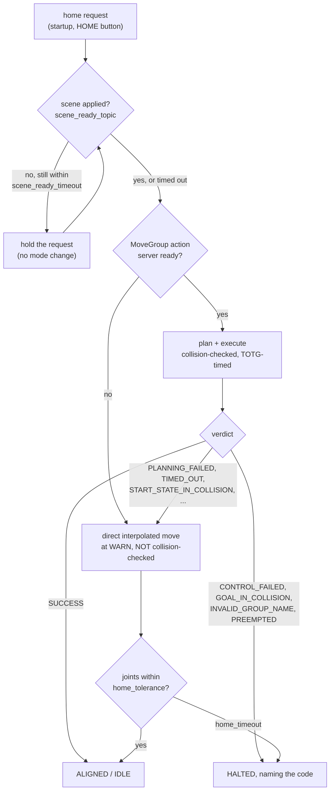
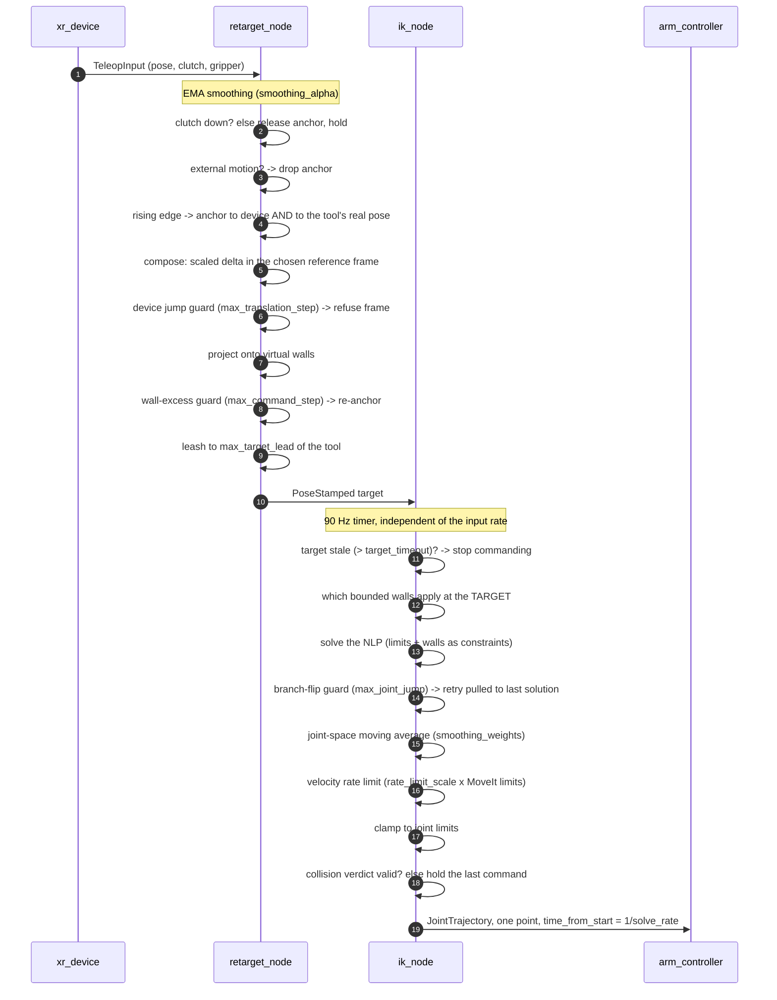
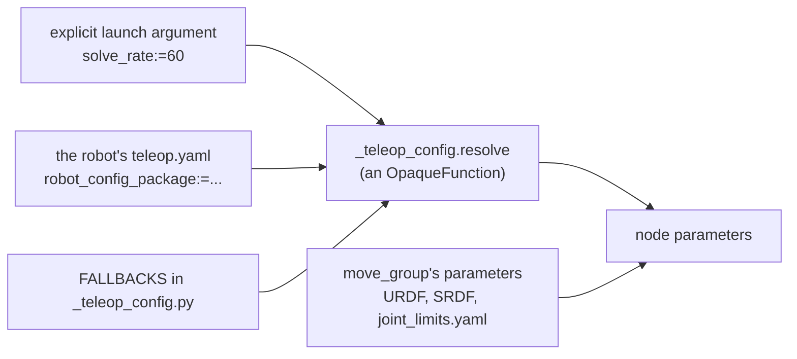
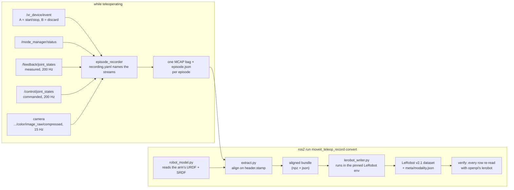
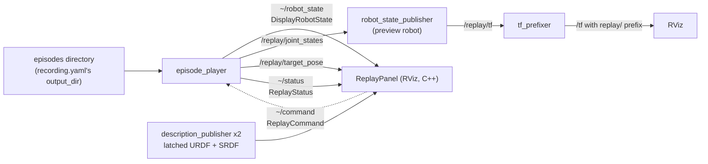

# Architecture: packages, signals, call flow

What runs, what it publishes, and the order in which one frame of hand motion
becomes one joint command. Read this before changing anything structural;
read [config-reference.md](config-reference.md) if you only need a number.

The whole stack is **robot-agnostic**: no file in this repository names a
link, a joint, a frame, a controller or a vendor. Everything robot-specific is
either read at runtime from the running `move_group` or declared in one file,
`<arm>_moveit_config/config/teleop.yaml`.

---

## 1. Packages

| Package | Build | Contains | Depends on |
|---|---|---|---|
| `moveit_teleop_msgs` | CMake | 6 messages, 2 services. No code. | — |
| `moveit_teleop_core` | Python | Retargeting, mode arbitration, gripper, scene, limit guard | msgs |
| `moveit_teleop_ik` | Python | The full-IK solver and its node | msgs |
| `moveit_teleop_devices` | Python | WebXR controller driver, scripted device | msgs |
| `moveit_teleop_record` | Python | Episode recorder, LeRobot exporter | msgs |
| `moveit_teleop_replay` | Python | Episode player, preview robot, TF prefixer | msgs, record |
| `moveit_teleop_rviz` | CMake | RViz replay panel (C++) | msgs |
| `moveit_teleop_bringup` | CMake | Launch files, config resolution, docs | all of the above |

Only `bringup` knows the stack exists as a whole. A package lower in that graph
can be used on its own: `moveit_teleop_ik` is a usable IK node for anything that
publishes a pose, and `moveit_teleop_record` exports datasets with no ROS graph
running at all.

Each package documents its own nodes, topics and parameters:
[core](../../moveit_teleop_core/README.md) ·
[ik](../../moveit_teleop_ik/README.md) ·
[devices](../../moveit_teleop_devices/README.md) ·
[record](../../moveit_teleop_record/README.md) ·
[replay](../../moveit_teleop_replay/README.md) ·
[msgs](../../moveit_teleop_msgs/README.md) ·
[rviz](../../moveit_teleop_rviz/README.md)

---

## 2. Runtime signal flow

The default path (`solver:=ik`, `device:=xr`) on real hardware. Solid arrows are
topics, dashed arrows are services, and the rate is what each link actually runs
at on the IQ9075 kit.

Three things in that picture are easy to get wrong:

- **`/control/joint_states` is a command bus on the Piper, not feedback.** The
  driver *subscribes* to it. Measured state is `/feedback/joint_states`, which
  is why hardware launches pass `joint_states_topic:=/feedback/joint_states`.
  On mock hardware the command echo *is* the state and the default is correct.
- **The robot model is read once, from `move_group`'s parameters** — never
  re-parsed from xacro, so every node reasons about the same robot the planner
  does.
- **Nothing downstream of `xr_device` knows what a headset is.** A second
  device publishes the same two topics and changes nothing else.

### Rates

| Link | Rate | Set by |
|---|---|---|
| Device → `/xr_device/input` | ~72 Hz | the headset's display refresh |
| Retargeting | one output per input | event-driven, not timed |
| IK solve → controller | 90 Hz | `ik.solve_rate` |
| Measured state | 200 Hz | the arm driver |
| Collision check | 20 Hz | `collision_check_rate` |
| Deadman watchdog | 50 Hz | `watchdog_rate` |
| Status publication | 20 Hz | `status_rate` |

---

## 3. Arbitration: the mode manager

Servo and `move_group` both want to command the same controller and preempt
each other, so exactly one component decides who is driving. It is also the
deadman: the solver keeps driving toward its last target if input merely stops
arriving, so *something* has to actively pause it.

```mermaid
stateDiagram-v2
    [*] --> IDLE: startup; with goto_ready:=true<br/>the arm is first trajectoried to ready_state
    IDLE --> ALIGNED: input healthy
    ALIGNED --> TELEOP: clutch squeezed
    TELEOP --> ALIGNED: clutch released
    ALIGNED --> IDLE: input stale
    TELEOP --> HALTED: watchdog fires (input_timeout)
    TELEOP --> HALTED: servo reports a halt code
    HALTED --> ALIGNED: input recovers
    IDLE --> PLANNING: ~/set_mode
    PLANNING --> IDLE: ~/set_mode
```

Homing is a `PLANNING`-mode activity, including at startup: the manager raises
a home request in its constructor and the first watchdog tick services it, so
the one motion nobody is driving happens under the same watchdog, e-stop and
status topic as everything else. `PLANNING` is also entered by `MARK_WAYPOINT`
+ `PLAN_AND_GO`, and directly through the `~/set_mode` service, which refuses
any live mode while input is stale.

### Posture moves: planned, with one fallback

Streamed commands are right for teleoperation and wrong for a move the operator
is not driving. A single trajectory point carries no path, so the controller
interpolates straight through whatever is in between — for a 90 Hz correction
that is fine, for a sweep across the workspace it is not. So posture moves go
through `move_group`'s `MoveGroup` action, which plans around the scene,
time-parameterises against the robot's own limits and returns a real verdict.

The split between those two verdict groups is the whole design. The fallback
codes all mean *move_group produced no path*, with the arm still where it
started and nothing executed — so interpolating is no worse than what this
stack did before it could plan at all, and refusing instead would turn a
conservative scene model into an arm that will not start.
`START_STATE_IN_COLLISION` is the one that matters in practice: a planner will
not plan out of a colliding start state, and a gripper resting on a modelled
table legitimately *is* in collision.

The other group means something executed, or the destination itself is bad, or
the configuration is wrong. Interpolating blindly after that is worse than
stopping and saying so. An unrecognised code does not fall back either: a
verdict nobody has reasoned about is not evidence that moving is safe.

**The fallback needs nothing robot-specific.** It publishes the same
`trajectory_msgs/JointTrajectory` to the same `<controller>/joint_trajectory`
topic that `ik_node` streams at 90 Hz, so any arm that can be teleoperated can
be homed this way — there is no per-arm adapter in that path. An arm whose
driver cannot take a `JointTrajectory` needs an adapter for live teleoperation
too, which is a vendor-driver gap rather than something this design introduces.

Returning to a `MARK_WAYPOINT` posture uses the same machinery with
`fallback_ok=False`: homing's excuse for blind interpolation is that its
destination is a posture the SRDF calls safe, and an arbitrary remembered
posture has no such excuse.

| Mode | Solver | Hardware gate | Meaning |
|---|---|---|---|
| `IDLE` | paused | closed | nothing engaged |
| `ALIGNED` | paused | closed | anchored to the device, clutch to engage |
| `TELEOP` | running | open | streaming retargeted motion |
| `PLANNING` | paused | *see below* | a posture move is executing |
| `HALTED` | paused | closed | watchdog, estop, or servo halt |

### The gate follows the command path, not the mode

Two kinds of gate exist on real drivers, and they want opposite things while a
planned trajectory executes:

| Kind | Example | During a planned move |
|---|---|---|
| **motion enable** | the Piper's CAN gate | must be **open**, or nothing moves |
| **streaming-mode select** | the Flexiv driver's `set_teleop_mode` | must be **shut**: the driver rejects a trajectory goal while its servo mode is active, and refuses to enter that mode while a trajectory runs |

`safety.hardware_gate.open_for_planning` picks between them, and only for
trajectory execution. Streaming is unambiguous — teleoperation and the homing
fallback both reach the arm by publishing to the controller topic, so both open
the gate whatever kind it is.

Getting this wrong on a streaming-mode gate is silent rather than loud: the
trajectory goal is rejected, a rejected goal reads as `PLANNING_FAILED`, that is
a fallback verdict, and so every planned home quietly becomes the unchecked
interpolated one while still looking planned.

`recording` is a flag on `TeleopStatus`, not a mode: an episode can legitimately
span `TELEOP` and `PLANNING`.

---

## 4. One frame, end to end

Where each guard sits, in order. The order is load-bearing — several of these
produce the opposite of their intent if moved.

Why these orders:

- **Project onto walls, then leash.** The leash clamps the target onto a sphere
  around the tool. A target half a metre under the table becomes a point in a
  mostly-downward direction, so sliding your hand sideways barely moves it — and
  the accumulated distance is covered at full rate the moment the target comes
  free. Projected first, the target sits on the table under your hand: close
  enough that the leash never bites, and free to move tangentially.
- **The device jump guard measures before projection; the wall-excess guard
  measures after it and subtracts the hand's own motion.** The first exists to
  catch an untrustworthy stream; the second to catch a wall appearing or
  vanishing under the target, which moves the command further than the hand
  moved. Swap them and ordinary motion across a wall edge re-anchors
  continuously.
- **The branch-flip guard compares consecutive SOLUTIONS, not the measured
  state.** The arm is rate-limited and legitimately trails its target;
  comparing against the measurement rejects every large smooth repositioning.
- **Rate limiting comes after smoothing and before clamping**, so the limiter
  sees what will actually be commanded, and the clamp is the last word.

---

## 5. Where the numbers come from

`explicit argument > robot config > fallback`, because launch cannot tell "the
caller did not pass this" from "the caller passed exactly the default". Every
argument the config owns is therefore declared with the sentinel
`UNSET = '<config>'` and filled by an `OpaqueFunction` placed after all
declarations and before all nodes. **A key the resolver does not know is an
error, not a silent skip.**

Anything readable from the robot model is never configured: joint names and
limits, the tip link, the planning frame, the controller's joints, the gripper's
open and closed values.

---

## 6. Recording and export

The exporter runs **offline**, so there is no `move_group` to ask — which is why
the robot config must name `files.preview_urdf`, `files.preview_srdf` and
`files.preview_xacro_args`. The camera drives the dataset timeline; the 200 Hz
joint streams are interpolated to each frame's capture time. Details and the
alignment measurement: [datasets.md](datasets.md).

Only `lerobot_writer.py` imports LeRobot, and it imports nothing from ROS — a
test asserts that against its AST, because the two environments cannot share an
interpreter.

---

## 7. Replay

The preview robot is drawn from a `DisplayRobotState` message, so it needs its
own URDF *and* SRDF, latched on dedicated topics; the TF prefix exists because
`robot_state_publisher` in Jazzy has no `frame_prefix` parameter and two
publishers of the same frame names interleave rather than merge.

The replay machinery is included **inside the teleop RViz** by default
(`replay:=true`). `moveit_teleop_replay`'s own `replay.launch.py` is for
reviewing episodes with nothing else running, and it requires the recorded
arm's model explicitly — nothing in a bag records which arm produced it.

---

## 8. What stops motion, and where

One row per guard, in the order a command meets them. Everything here is
announced at startup by `ik_node`'s `guards:` line, including anything disabled
(at WARN) — read it before trusting any tuning measurement.

| Guard | Lives in | Trips on | Effect |
|---|---|---|---|
| Planned path | `move_group` | posture moves only (homing, waypoint return) | path avoids the scene; refusals fall back or halt per verdict |
| Clutch | `retarget_node` | button released | anchor dropped, arm holds |
| Tracking loss | `retarget_node` | `pose_valid` false | anchor dropped, arm holds |
| `max_translation_step` | `retarget_node` | device teleport | frame refused |
| `max_command_step` | `retarget_node` | a wall moved the command further than the hand | re-anchor, arm holds |
| `max_target_lead` | `retarget_node` | target outran the tool | target clamped to a sphere |
| Virtual walls | both | target crosses `n·p ≥ d` | target projected; tangential motion preserved |
| `input_timeout` | `mode_manager` | input stale | `HALTED`, solver paused, gate closed |
| `target_timeout` | `ik_node` | no fresh target | stops commanding |
| Joint limits | `ik_node` | always (constraints in the NLP) | solution stays feasible |
| `max_joint_jump` | `ik_node` | IK branch flip | one retry, else hold |
| `rate_limit_scale` | `ik_node` | operator outruns the arm | step clipped, `rate_limited` set |
| `collision_policy: stop` | `ik_node` | candidate state in collision | hold the last valid command |

Acceleration is **not** enforced on the streaming path: MoveIt's acceleration
limits are planning limits and are not applied to a command this stack builds
itself, so smoothing plus the velocity limit are what bound the jerk during
teleoperation. A trajectory-level smoother (Ruckig is installed but not wired
in) is the real fix. Planned posture moves are the exception — `move_group`
time-parameterises those against both limits, scaled by `home_scaling`.
